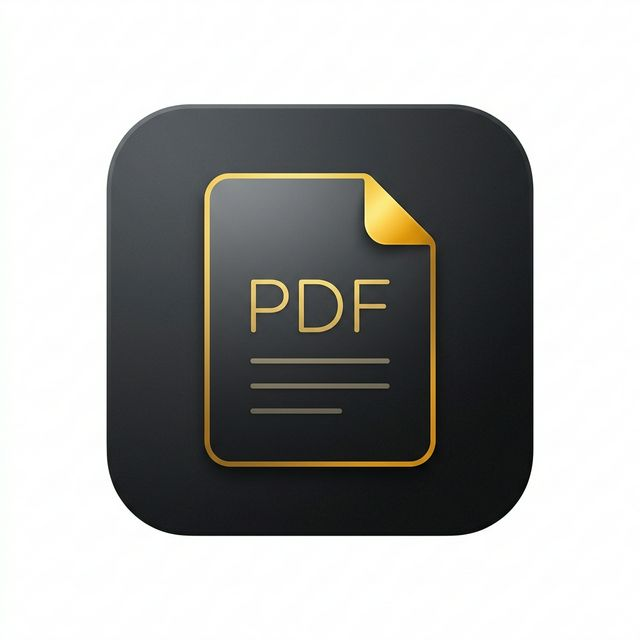
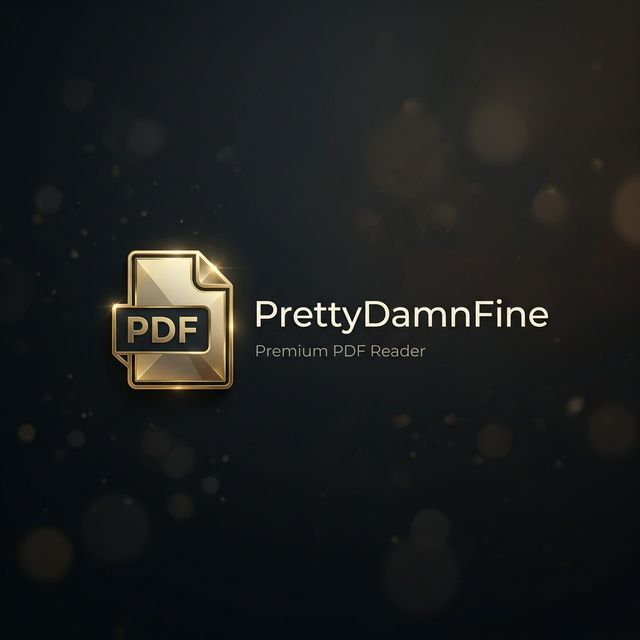

<div align="center">



# PrettyDamnFine

**A fast, distraction-free Android PDF reader**

[](https://www.gnu.org/licenses/agpl-3.0)
[](https://f-droid.org/)

<br/>


</div>

---

## Overview

PrettyDamnFine is a private, offline-first PDF reader built for deep work. It uses the native **MuPDF** engine for crisp rendering, real PDF annotations, and accurate text selection — with no network access and no accounts.

## Features

- **Fast native rendering** — MuPDF 1.28.5, bounded bitmap cache, page prefetch, fast scrolling.
- **Annotations** — select text and add a real PDF highlight; remove it the same way; save edits back to your private working copy.
- **Library management** — search, sort (recent / oldest / name), multi-select with long-press, delete files from device, and share any PDF.
- **Reading themes** — light, dark, sepia and auto for the page; a dedicated light/dark toggle on the home screen for the app UI.
- **Gestures** — pinch zoom, double-tap zoom, read mode, fast scrollbar, page overview, and proper system Back handling.
- **Local text search** — search extracted text, jump between matches, and see highlighted results on the page.
- **Privacy** — no internet permission, no analytics, no cloud. Your documents stay on your device.

> AI features were removed in v2.0.2. The app is fully offline.

## Building

Requires Android SDK Platform 36 and Build Tools 36.0.0. MuPDF is resolved from Artifex's Maven repository configured in `settings.gradle.kts`.

```bash
git clone https://github.com/Blprk/PrettyDamnFine.git
cd PrettyDamnFine
./gradlew assembleRelease
```

Set `sdk.dir` in `local.properties`. Release builds currently use the debug signing key.

## Documentation

- [CHANGELOG.md](CHANGELOG.md) — full change history.
- [PROPOSAL.md](PROPOSAL.md) — architecture decisions and roadmap (historical; includes the removed AI proposal).

## License

Licensed under the **GNU AGPL v3.0 or later** ([LICENSE](LICENSE)) because MuPDF is AGPL-3.0. Original Apache-2.0 code is retained in [LICENSE-APACHE.txt](LICENSE-APACHE.txt).
